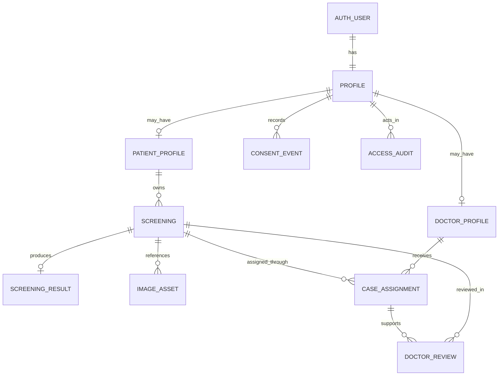
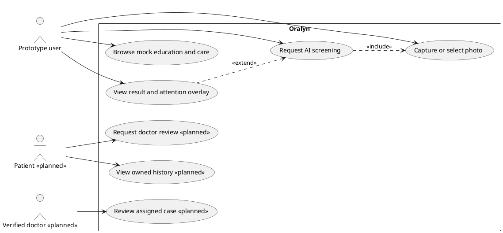
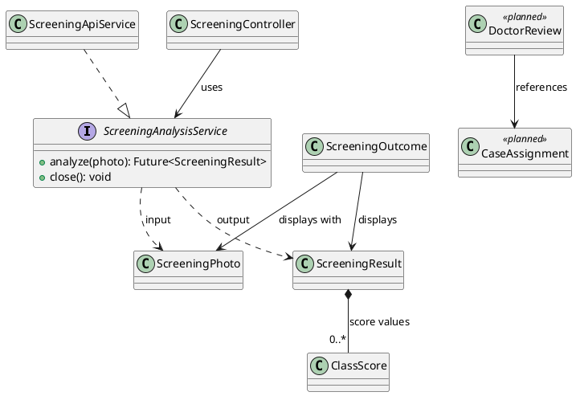
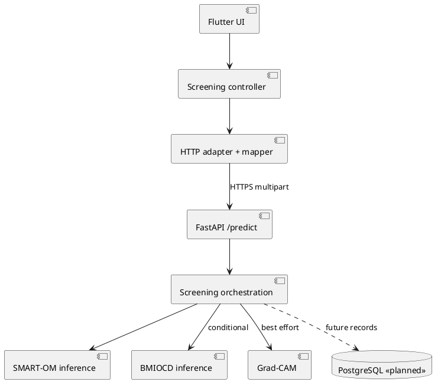
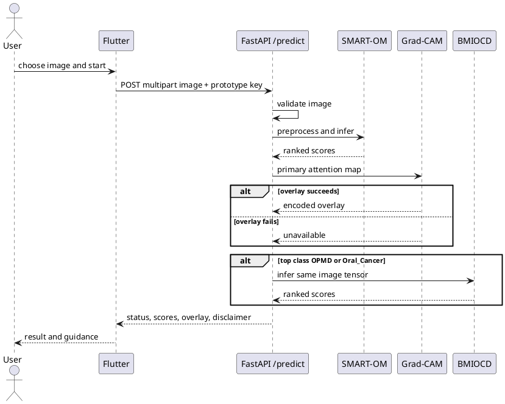
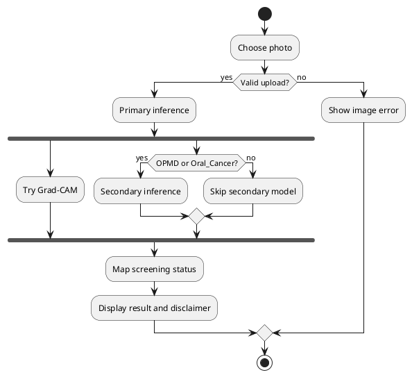
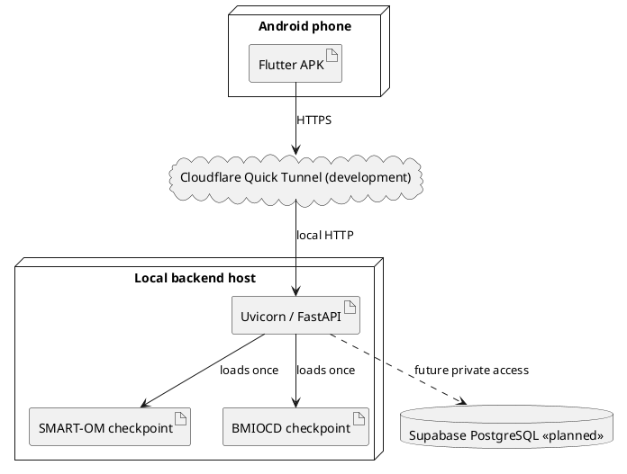

# Oralyn architecture and next-phase design

This document distinguishes implemented behavior from proposed boundaries. The current system is a research prototype, not a diagnosis or a patient-record system. See [the audit](ARCHITECTURE_AUDIT.md) for evidence, severity and change gates.

The FastAPI boundary and model-loading structure described below were implemented in Phase 2; see [the implementation report](PHASE2_BACKEND.md). The following “current data flow” describes the pre-Phase-2 baseline for historical comparison. Patient, doctor and database components remain plans only.

## Current data flow and responsibilities

`image_picker` supplies one `ScreeningPhoto` in memory. `AnalysisScreen` calls `ScreeningController`, which calls `ScreeningApiService`. The service builds a multipart `POST /predict` with `image` and a shared `x-api-key`, parses the JSON and maps backend classes/statuses to `ScreeningResult`. `ResultScreen` displays the result; history, doctors and authentication remain mock flows. The URL comes from `shared_preferences` or the build default. No result is stored.

FastAPI imports both ResNet50 checkpoints, applies 224×224 resize, tensor conversion and ImageNet normalization, predicts with the SMART-OM model, attempts primary-model Grad-CAM under a lock, and calls the BMIOCD model only for primary OPMD or Oral_Cancer. A Grad-CAM exception leaves the prediction available. The route currently owns upload handling, orchestration and response construction.

The primary Normal and Variation_from_Normal branches **never reach secondary verification**. This is a possible false-negative route. No threshold, class order or clinical claim should be changed without model evaluation and approval.

## Proposed boundaries, introduced only when used

| Boundary | Responsibility | Dependency direction |
|---|---|---|
| Flutter screening presentation | Capture, progress, retry and display | Calls a focused screening controller/use case |
| Flutter screening domain | Result, score breakdown, explainability metadata, typed errors | No HTTP or widget dependency |
| Flutter screening data | Multipart client and response mapper | Implements `ScreeningAnalysisService`; maps external schema once |
| Backend API | Authentication dependency, bounded upload, response/error contract | Calls screening service |
| Backend screening service | Explicit two-model chain and guidance rule | Depends on prediction and Grad-CAM collaborators |
| Backend AI adapter | Checkpoint load, preprocessing, inference, optional Grad-CAM | Uses PyTorch/Pillow; no request or database logic |
| Future record repository | Owned screening, assignment and review access | Implemented using PostgreSQL/Supabase behind a focused contract |
| Future object authorization | Checks actor, case ownership, assignment, doctor verification | Enforced at API and data-access boundaries |

Keep the existing Flutter folders until a feature grows enough to justify a move. A likely next layout groups `screening/{presentation,domain,data}` and later `authentication`, `history`, `patient`, `doctor`, while retaining `core/theme`, routing and shared widgets. For the backend, `api/predict.py`, `services/screening.py`, `ai/models.py`, `ai/gradcam.py`, `core/config.py` and `schemas/prediction.py` are the smallest useful split. Do not create empty repositories or a generic service factory.

## Design fundamentals and patterns

`ScreeningOutcome` associates a result with the in-memory photo; neither owns the other's lifetime. `ScreeningResult` can compose `ClassScore` values and explainability metadata because those values exist as parts of a single result. A patient has an association with many screening records; records may need retention independent of an account lifecycle, so no cascade or composition is assumed. A doctor is associated through `CaseAssignment`, and a review references a screening case. An assignment never owns patient or doctor identity. No current entity needs inheritance.

The existing `ScreeningAnalysisService` is useful dependency inversion and permits a mock implementation. The proposed response mapper addresses single responsibility: parsing and class/status interpretation currently change inside the HTTP transport service. Constructor injection remains sufficient; a container or factory adds no value yet. `ChangeNotifier` is an appropriate observer for UI state once state is private and late async results are guarded. A repository pattern becomes appropriate when persistent records exist; introducing it for fixed mock lists would add ceremony. A prediction strategy is useful only if interchangeable deployed model providers become real; the current conditional two-model chain should remain explicit. An adapter is justified at the HTTP JSON boundary. Each abstraction adds files and contracts, so test the real seam before extracting it.

Encapsulation should keep controller result/loading/error state read-only outside the controller. The Liskov contract for any `ScreeningAnalysisService` is: return a valid `ScreeningResult` for a completed screening or throw a typed failure; `close` releases owned resources. Interface segregation means auth, screening and persistence operations stay separate. High cohesion comes from putting one model chain in the screening service; low coupling comes from hiding HTTP, PyTorch and future Supabase details at their boundaries. DRY applies to repeated response mapping and status text, while KISS/YAGNI argues against speculative roles, base classes and empty layers.

## Security, error and operation contracts

- **Prototype only:** `ORALYN_API_KEY` is a backend environment variable and a build-time Flutter value. `dart-define` does not protect a client secret. Rotate any key exposed in earlier APKs or builds before wider access. Replace the shared key with short-lived authenticated identity and server-side authorization before real patient data.
- Accept image uploads only over HTTPS in deployment. Bound bytes while reading and constrain decoded pixel count. Do not trust filename or MIME alone. Keep storage private and authorize every image retrieval.
- A future patient may read only owned or explicitly granted records. A doctor needs verified status **and** an active case assignment; role membership alone is insufficient. Check this at every protected API and with database row policies. Record access and review events without logging images, tokens or detailed health data.
- Use separate technical errors and user messages: 400 malformed image, 401 unauthenticated, 403 forbidden case, 413 oversize, 429 rate limited, 503 model/service unavailable. Timeouts and network failure remain typed on mobile. Do not retry a request that persists a record without an idempotency key.
- Keep image storage reference and result metadata separate. Establish consent, retention, deletion, encryption and backup policies before records are created. Do not cascade-delete medical records by default.
- Health checks should report model readiness when backend startup is modularized. A missing or corrupt checkpoint should fail startup rather than serve a false healthy status.

## Database readiness (design only)

Use migrations. `profiles` extends the authentication provider's user ID with display data and role; `patient_profiles` and `doctor_profiles` hold role-specific attributes. Doctor verification needs an explicit review process. `screenings` owns request metadata and state, `screening_results` is a 0-or-1 result per screening, `image_assets` stores private object keys rather than public URLs, `case_assignments` grants a verified doctor a case, and `doctor_reviews` references an assignment and case. `consent_events` and `access_audit` are retained event tables once policy is defined. Avoid duplicating auth passwords or storing base64 overlays in rows.

Keys and constraints: UUID primary keys; `profiles.id` references auth user ID; `screenings.patient_id` references `patient_profiles.user_id`; `screening_results.screening_id` is unique; `case_assignments(screening_id, doctor_id)` is unique for active assignments; review references a valid assignment and screening; image asset stores a private object key and owner. Restrict deletion according to approved retention policy. Index `screenings(patient_id, created_at DESC)`, `case_assignments(doctor_id, status, created_at DESC)`, and `doctor_reviews(screening_id, created_at DESC)` for anticipated dashboards. Enforce status and role domains with check constraints. Use one transaction for screening metadata plus result reference and one for assignment/review status changes; object storage upload needs compensating cleanup because it is outside the database transaction. Generate migrations in a later phase; no database is connected now.

Planned API contracts: authenticated screening creation with an idempotency key; patient-owned list/detail; review request; doctor assigned-case list/detail; doctor review submission and status transition. Return 403 or 404 without disclosing unrelated case existence. Never accept patient ID or doctor assignment from the client as proof of authority.

## Decision records

**ADR-01 — Keep `/predict` stable.** Preserve multipart field and response fields during backend extraction. Consumer tests protect mobile mapping. Tradeoff: legacy JSON remains until a versioned API is justified.

**ADR-02 — Separate model scores from clinical meaning.** Continue displaying model output as a score with a visible disclaimer. Do not interpret it as a calibrated disease probability. Tradeoff: less familiar wording, but accurate for the current evidence.

**ADR-03 — Defer Supabase integration.** Define ownership, RLS and retention first. Tradeoff: history remains demonstrably mock; no false claim of persistence.

**ADR-04 — Keep current chain.** Preserve conditional BMIOCD verification and Grad-CAM fallback pending evaluation. Tradeoff: primary low-concern outputs bypass verification, and secondary performance is not established for the full chain.

## UML: current and planned behavior

PlantUML diagrams below use `<<planned>>` to mark future behavior. They are source diagrams, not evidence that a future feature has been implemented.

### Use cases

### Class relationships

### Components

### Screening sequence

### Activity

### Deployment

The use-case `extend` relation describes result viewing after screening; there is no automatic doctor review in the current flow. The class diagram uses composition only for score values. Other references are associations or dependencies. Database relationships are referential links, with retention and deletion policy still undecided.
