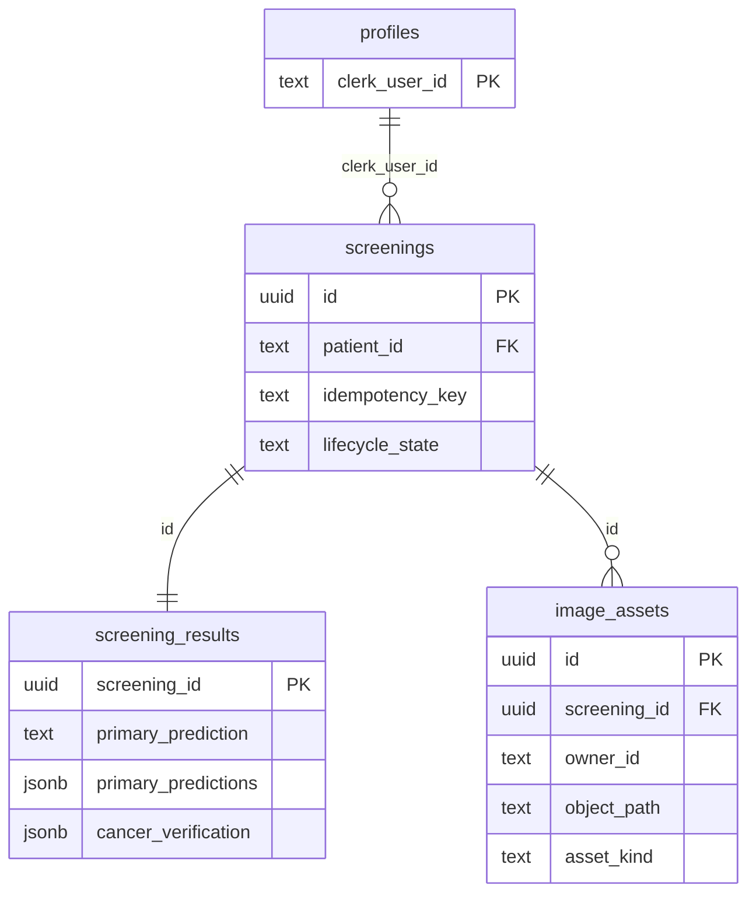

# Phase 3B: Supabase screening history

Status: implementation, live project configuration, migration, transactional
RLS assertions, and automated regression tests are complete. Authenticated
mobile save/logout/login/read, second-account isolation, and private-object
round-trip verification remain open because no Android device or reusable
Clerk test token was available at the end of the setup session. Do not treat
this phase as production ready.

## Architecture

Clerk remains the identity provider. FastAPI verifies the Clerk session before
every history request. It sends the same session token to Supabase Data API and
private Storage reads with a publishable key. Native Clerk third-party auth
accepts that token, and Postgres policies compare the string `sub` to the
patient/owner columns. The backend's modern Supabase secret key is used only
for authoritative writes and deletion after its own identity and ownership
checks. It is never packaged in Flutter. The deprecated Clerk JWT template and
Supabase Auth are not used.

The `Save result` action uploads the selected photo again to `/screenings`.
FastAPI validates the same 10 MB and 4 million pixel bounds, reruns the
unchanged two-model chain, stores the original and available Grad-CAM image in
the private bucket, then calls a transactional metadata RPC. This extra model
run prevents a client from changing its own prediction by submitting edited
JSON. The existing `/predict` response remains unchanged. A generated
idempotency key survives retries while the result page is open.

## Deployment to the existing projects

The existing development projects were configured on 11 November 2026. The
native Clerk Supabase integration is enabled, Supabase trusts the development
Clerk domain as a third-party provider, and the migration below has been
applied. These steps remain the deployment checklist for another environment.

1. In the existing Clerk Dashboard application, activate **Connect with
   Supabase**. This adds `role: authenticated` to Clerk session tokens.
2. In the existing Supabase project, enable **Clerk** under Authentication →
   Third-Party Auth using that Clerk domain. Keep the current publishable
   `sb_publishable_…` key and create a scoped server `sb_secret_…` key.
3. Set `SUPABASE_URL`, `SUPABASE_PUBLISHABLE_KEY`, and `SUPABASE_SECRET_KEY`
   in `D:\oralyn-backend\.env` outside this repository. The URL must be the
   HTTPS project origin. Keep `SUPABASE_STORAGE_BUCKET=screening-images` or
   omit it; the migration fixes that bucket name. Do not commit or paste key
   values into logs/chat.
4. Review and apply
   `supabase/migrations/202611110001_phase3b_screening_history.sql` to a
   staging project first, then production. Run the pgtap assertions in
   `supabase/tests/phase3b_rls_checks.sql` in staging. The script rolls back
   its synthetic records; it requires the pgtap extension. Verify authenticated
   storage read, cross-user denial, and unavailable anonymous reads manually.
5. Restart the FastAPI server. Run a new screening on the mobile device, tap
   **Save result**, sign out, sign back in with the same Clerk account, and
   confirm history/detail/original/Grad-CAM. Sign in as a second account and
   confirm no access to the first account's saved record or asset. Delete the
   synthetic screening and confirm its metadata and objects are removed.

## API and failure behavior

- `POST /screenings`: authenticated multipart `image` and
  `idempotency_key`; returns the stored result plus private asset paths.
- `GET /screenings`: up to 100 newest owned records; no pagination yet.
- `GET /screenings/{id}`: owned detail, otherwise 404.
- `GET /screenings/{id}/assets/{original|gradcam}`: authenticated image proxy,
  `Cache-Control: private, no-store`.
- `DELETE /screenings/{id}`: owner only; confirmation is in Flutter.

Before the metadata transaction commits, upload failures trigger best-effort
cleanup. After commit, a failed read leaves the durable row intact, and the
same idempotency key recovers it on retry. Deletion first hides the row as
`deleting`, then removes storage, then deletes metadata. A partial storage
failure leaves the row hidden and a retry resumes cleanup. Operations across
Postgres and Storage are not a single distributed transaction; monitor the
privacy-safe `screening_save_cleanup_failed` and deletion failures and build
an operational reconciliation job before production use.

## Changes and security effects

| Area | Modification and reason | Security benefit and remaining risk |
| --- | --- | --- |
| Migration | Normalized profiles, screenings, results, and asset metadata; ownership indexes and unique idempotency key | RLS isolates reads; SQL must still be exercised in the existing Supabase project |
| Storage | Private bucket, MIME and size restrictions; owner-path read policy | No public image URLs; server secret can bypass RLS and requires strict protection |
| FastAPI | User token for RLS reads, trusted inference for writes, generic errors and bounded upload | Clients cannot forge model output; save runs inference a second time |
| Flutter | Authenticated save, real history/home preview, private asset fetch, deletion confirmation | No local patient database; reopening history requires network access |

No new clinical guidance, thresholds, model weights, preprocessing, or
`/predict` success fields were changed. Original images and Grad-CAM are
sensitive; explicit retention duration, account deletion cascade, backups,
audit logging, pagination, and reconciliation remain before production.

## Tests observed on 11 November 2026

- Native Clerk integration: enabled for the existing development instance;
  Supabase reported the Clerk third-party provider connection as enabled.
- Live migration: applied successfully to the existing Supabase project. A
  follow-up query confirmed all four tables, the private `screening-images`
  bucket, and four public-table policies.
- Live RLS suite: 8/8 pgtap assertions passed. The checks covered owner-only
  reads, Clerk `sub` ownership, cross-user denial, blocked authenticated
  inserts/deletes, private storage, and the 10 MB bucket limit. The transaction
  rolled back its synthetic rows.
- Backend synthetic contract suite: 26/26 tests passed with generated images
  and mocked inference.
- Real-checkpoint smoke: passed with a generated 256x256 image; invalid image
  returned 400, Grad-CAM was available, deliberate Grad-CAM failure preserved
  a 200 prediction, and conditional verification matched the primary class.
- Flutter analysis: no issues.
- Flutter suite: 18/18 tests passed through a temporary `O:` alias because the
  generated package configuration references that alias for the local Flutter
  SDK. The alias points to the same workspace and is not part of the app.
- Still open: authenticated private-object round trip, mobile
  save/logout/login/retrieve, second-account denial through the deployed API,
  and cleanup confirmation. The connected Samsung device was unavailable and
  no reusable Clerk session token was retained.

Reference: [Supabase Clerk third-party auth](https://supabase.com/docs/guides/auth/third-party/clerk),
[Clerk integration](https://clerk.com/docs/guides/development/integrations/databases/supabase),
[Supabase Storage access control](https://supabase.com/docs/guides/storage/security/access-control),
and [API key security](https://supabase.com/docs/guides/getting-started/api-keys).
