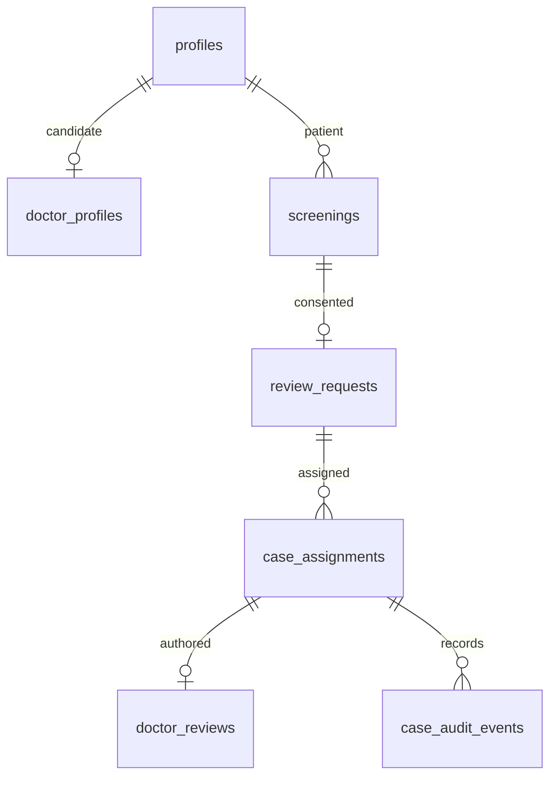

# Phase 3C authorization foundation

Status: source implementation and synthetic API tests are in progress. The
`202611120001` migration has **not** been applied or verified in the Supabase
development project. The Phase 3C gate is not complete.

## Verified Phase 3B evidence

On 12 November, the current APK and real Clerk test account reached FastAPI
through the temporary HTTPS tunnel. `POST /predict`, `POST /screenings`,
history reads, and private original/Grad-CAM reads returned 200. The stored
synthetic result was `Normal` and conditional verification was skipped. The
user reported logout/login worked. A second-account API denial and deletion
cleanup were not observed. The synthetic screening remains in development
storage. The tunnel and server were stopped.

## Proposed deployment boundary

`profiles.application_role` defaults to `patient`. Only server-role
administrative SQL can enroll a Doctor candidate and change verification
state. Enrollment requires a distinct `doctor_profiles` row. A Doctor read
requires a verified state and active assignment at query time through
`can_review_screening`; no Clerk metadata role is used.

The patient creates one review request per screening with explicit consent.
Only a trusted operator can assign or revoke a Doctor. A verified, assigned
Doctor can save a draft or submit once; `expected_version` prevents a stale
edit. Case opens and review writes create privacy-safe audit events. A
submitted review is immutable. Revocation and suspension are checked
against PostgreSQL on each case read/write and on private asset reads. A
screening with a review request cannot be deleted until retention rules are
defined; FastAPI returns 409 before removing any object.

| Actor | Own screening | Request review | Assigned case | Save review | Verify/assign |
| --- | --- | --- | --- | --- | --- |
| Patient | Read, save, delete when no case | Yes with consent | No | No | No |
| Verified Doctor | Only if assigned | No | Read | Draft/submit | No |
| Pending/suspended Doctor | No patient cases | No | No | No | No |
| Trusted operator | Controlled maintenance | No | Assign/revoke | No | Yes |

## API contracts in source

- `GET /me`: verified Clerk identity, default Patient provisioning, database
  role and own Doctor verification state.
- `POST /screenings/{id}/review-request`: `{consent_to_share:true}`; creates
  or returns the one existing request for an owned saved screening.
- `GET /review-requests`: own persisted request states.
- `GET /doctor/cases`: only verified Doctor assignments allowed by RLS.
- `GET /doctor/cases/{assignment_id}`: assigned screening and draft, if any.
- `GET /feedback`: submitted feedback for the owning Patient only.
- `PUT /doctor/cases/{assignment_id}/review`: bounded text, submit flag and
  expected version; SQL transaction controls status, review and audit event.

Administrative enrollment, verification, assignment and revocation are
database-only functions granted to `service_role`. A separate authenticated
operator procedure and audit policy are required before these can be treated
as production administration. Never expose the server key in Flutter.

## Tests and open gates

The existing 26 backend tests and 18 Flutter tests passed before changes.
After the initial foundation, 29 backend tests and 24 Flutter tests passed;
Flutter analysis found no issues after the unused import was removed. These
are synthetic tests. The Phase 3C SQL test file is prepared but has not run.

Before enabling role routes on the phone: apply the migration to the existing
development project, run the transactional SQL assertions, verify actual
Clerk-backed Patient and Doctor access, test suspension and revocation, and
complete the second-account and deletion checks. Retention, rate limiting,
operator authentication, and review content policy remain production gates.
