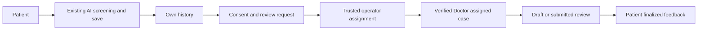
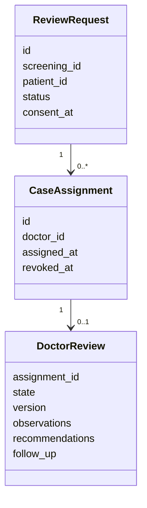
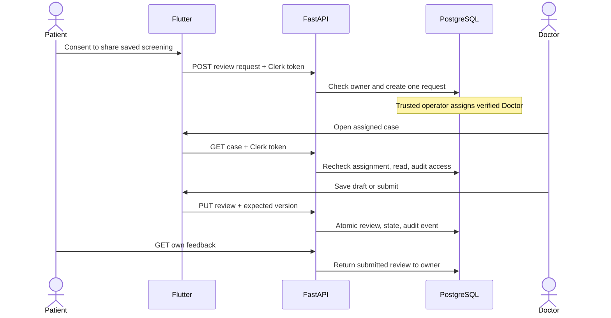
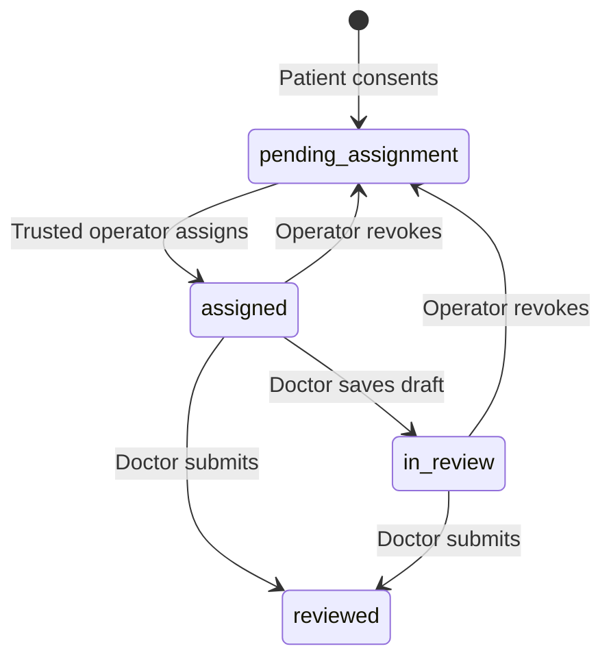
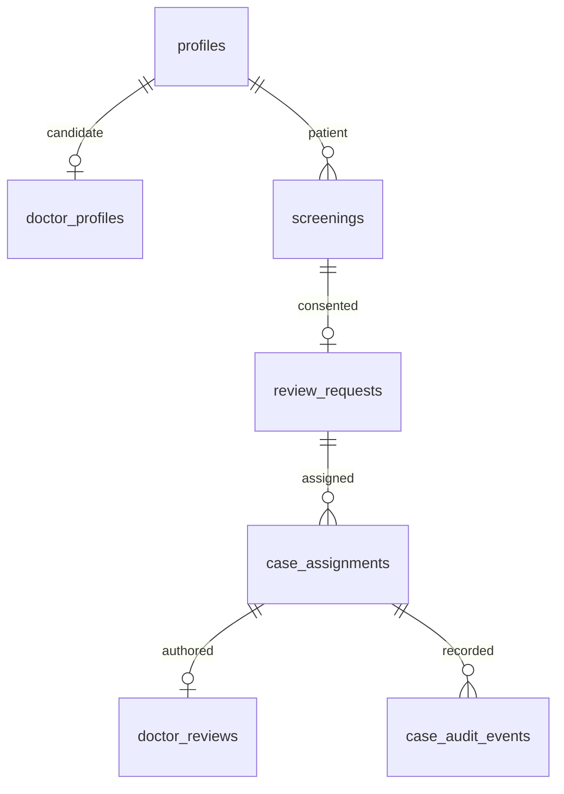

# Phase 4 Patient and Doctor workflow

**Status: source implementation, not deployed or accepted.** The Phase 3C
migration has not run against the development Supabase project. Real Clerk,
RLS, Storage, assignment and Android end-to-end checks remain release gates.
Use synthetic records only. AI checkpoints, preprocessing, thresholds,
guidance and the `/predict` contract were not changed.

## Implemented behavior

The existing Patient shell handles image capture, AI screening, saved history
and private images. Home shows real recent history and review counts, with
separate unavailable and empty states. Saved-screening detail explains
sharing, obtains consent, submits an idempotent review request, shows the
persisted state and retrieves finalized Doctor feedback separately from the
AI result. A screening with a review request cannot be deleted until a
retention and deletion policy is approved.

The role entry point reads the current database profile. A verified Doctor
sees an assigned-case workspace, persisted case counts and filters,
professional profile fields and private case details. Details show the
original image, AI scores, secondary verification when performed, Grad-CAM
and original guidance. The form saves a draft or submits user-entered
observations, recommendations and follow-up. It warns before discarding
unsaved text. It does not manufacture clinical content.

FastAPI verifies Clerk sessions and reads the current database role. Case
detail and review writes require current verification and assignment. RLS
and atomic RPCs check those conditions again. The review RPC locks the
request, checks `expected_version`, updates the review and case state in
one transaction, and writes an audit event. Case detail invokes an
authorized audit RPC before returning protected content. Direct database
reads are governed by RLS but are not individually audited.

## Workflows and diagrams

`closed` is reserved in the database constraint but has no implemented
transition. A submitted review is immutable. Revocation blocks later Doctor
reads and writes; finalized feedback remains visible to the Patient.
Reassignment creates a new assignment and does not transfer the old draft.

## Schema and access

Migration: `supabase/migrations/202611120001_phase3c_authorization.sql`.
`profiles.application_role` defaults to Patient. `doctor_profiles` stores
verification fields. `review_requests` is unique per screening and
references its owner. `case_assignments` allows one active assignment per
request. `doctor_reviews` is unique per assignment and versioned.
`case_audit_events` records case opens, draft saves and submissions without
image content or clinical text.

| Actor | Own screening | Request review | Assigned case and image | Review write | Verify/assign |
| --- | --- | --- | --- | --- | --- |
| Patient | Read; delete if no request | With consent | No | No | No |
| Verified assigned Doctor | Assigned case only | No | Read while active | Draft/submit with version | No |
| Pending/suspended Doctor | No patient case | No | No | No | No |
| Trusted operator | Controlled maintenance | No | Service role | No | Service-role RPC only |

Private assets remain in `screening-images`. Flutter receives authenticated
FastAPI asset paths, never permanent public Storage URLs or a server key.
Storage and metadata policies check current assignment and verification.
Flutter role navigation is not an authorization boundary.

## API contracts

| Endpoint | Result | Authority |
| --- | --- | --- |
| `GET /me` | Current role and own Doctor profile | Verified Clerk subject; server-only Patient provisioning |
| `GET /screenings`, `GET /screenings/{id}` | Existing screening data | Owner or assigned Doctor through RLS |
| `GET /screenings/{id}/assets/{kind}` | Private image bytes | Metadata and Storage RLS |
| `POST /screenings/{id}/review-request` | Existing/new ID and status | Patient, consent, owned saved screening |
| `GET /review-requests`, `GET /feedback` | Own states/final feedback | Patient and owner RPC/RLS |
| `GET /doctor/cases` | Active assignments | Verified Doctor and RLS |
| `GET /doctor/cases/{id}` | Case, screening, review | Current assignment, verification, audit |
| `PUT /doctor/cases/{id}/review` | ID, version, state | Current assignment, transactional version check |

Enrollment, verification, assignment and revocation are service-role database
functions. There is no public administrator portal. The operator identity is
currently supplied to those functions; an authenticated operator procedure
and independent admin audit are required before production use.

## Verification and open gates

The UI uses focused HTTP services; FastAPI routes validate requests; the
persistence adapter owns REST and Storage calls; PostgreSQL owns the
authorization and transaction boundary. Existing visual tokens and Patient
navigation remain in place.

- Baseline: 26 backend and 18 Flutter tests passed.
- Current source: 29 backend tests and 29 Flutter tests passed. Flutter
  analysis found no issues. Rerun after final source changes.
- Real SMART-OM and BMIOCD checkpoints passed a synthetic-image API smoke:
  invalid image 400, real Grad-CAM generated, conditional verification
  matched the primary class, and Grad-CAM failure kept prediction available.
- The SQL pgtap checks in
  `supabase/tests/phase3c_authorization_checks.sql` have **not run**.
- No role-aware APK, live Doctor account, trusted assignment, cross-account
  RLS denial or full Patient-to-Doctor-to-Patient flow has been tested.

Browser control stopped because it could not determine the current Windows
browser URL confidently enough to enforce policy. No live schema change was
made. The installed APK is still from Phase 3B.

Apply and verify the migration in development, then run the transactional SQL
tests. Test real Clerk Patient and verified/suspended Doctor accounts,
assignment/revocation, Storage isolation, concurrent writes and Android
navigation. Complete history pagination, per-row review status, case-list
clinical summary, authenticated operator workflow, direct-read audit coverage,
rate limits, retention/deletion policy and device accessibility review.
Do not use identifiable patient data until those privacy controls are
approved. Phase 5 integration should wait until these gates pass.

The copy-paste development setup and complete acceptance sequence are in
[`PHASE4_MANUAL_TESTING.md`](PHASE4_MANUAL_TESTING.md). The read-only
`scripts/Test-Oralyn-Phase4Prerequisites.ps1` checker confirms local runtime
files, private configuration presence and Phase 3C schema readiness without
printing keys or changing database state.

## Git checkpoints

- `65b1022` — database roles, assignments, review RLS and SQL checks.
- `c05b0d6` — authenticated case API, persistence and backend tests.
- `cf76545` — Patient review consent, status and feedback UI.
- `9658d6c` — Doctor workspace, role routing and Flutter tests.
- `f967594` — Phase 3C and Phase 4 architecture documentation.
